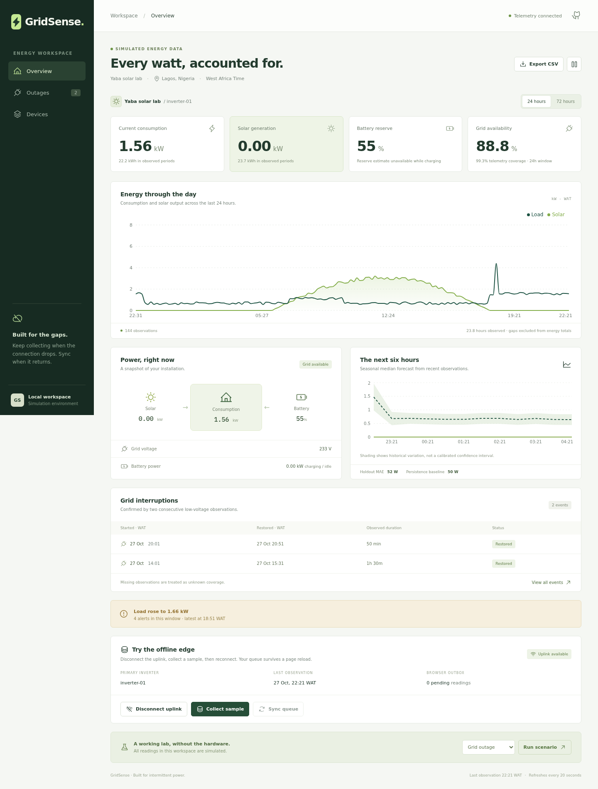

# GridSense

Solar, battery, and grid telemetry with offline collection and replay.

GridSense records grid voltage, solar production, consumption, and battery reserve. Devices retain observations in a local outbox during network failures. The API accepts delayed batches and identifies duplicate or conflicting events by UUID.

This is a runnable reference implementation. Its demo readings and replay fixtures are **synthetic**, not field measurements. The 2021–2023 commit dates are a documented reconstruction created in October 2026 for a contribution-calendar exercise; they do not represent work performed in those years. See [provenance](docs/provenance.json).



## Run the complete demo

Requirements: Python 3.12+, [uv](https://docs.astral.sh/uv/), and Node.js 24+.

```bash
uv sync --locked --extra dev
npm --prefix frontend ci
npm --prefix frontend run build
uv run uvicorn gridsense.api:app --host 127.0.0.1 --port 8000
```

Open **http://127.0.0.1:8000**. The first startup generates 72 hours of deterministic demonstration data. Interactive API documentation is at **/docs**. There are no external cloud services or API keys needed for this mode.

For separate development servers, run the API on port **8788** and `npm --prefix frontend run dev` on **5188**. Vite proxies `/api` to port 8788. Service-worker shell caching is enabled in production builds, including a locally served build.

### Try three real flows

1. **Offline collection:** open Devices, choose **Disconnect uplink**, and collect several samples. Reload the page: the IndexedDB outbox remains. Choose **Sync queue** or reconnect. Entries are removed only after the server acknowledges their event IDs.
2. **Grid interruption:** choose **Grid outage → Run scenario**. Two low-voltage observations create a confirmed event. After three seconds, choose **Grid restoration** to close it.
3. **Explainable alerts:** run **Load spike** or **Low battery**, inspect the alert, and export the underlying readings as CSV.

The dashboard refreshes every 20 seconds. It does not manufacture live observations while the simulator is idle. The most recent timestamp remains visible, and telemetry becomes stale after 20 minutes.

## What is implemented

| Area | Behavior |
|---|---|
| Ingestion | Authenticated batches, UUID event identities, range and timezone validation, transactional replay, conflicting-payload detection |
| Edge | SQLite WAL outbox; restart recovery; bounded batches; retry backoff; graceful shutdown |
| MQTT | QoS 1 subscriber → durable SQLite spool → authenticated HTTP; broker acknowledgement follows the local durable write |
| Dashboard | React/TypeScript, responsive energy charts, outage timeline, device state, CSV downloads, simulation controls |
| Browser offline mode | Service-worker app shell, IndexedDB telemetry outbox, saved demo snapshots, acknowledgement-safe replay |
| Outages | Debounce and voltage hysteresis; telemetry gaps break observation coverage instead of becoming assumed outages |
| Forecasting | Seasonal-median load/solar baseline; time-ordered holdout MAE alongside a persistence baseline |
| Alerts | Rolling median/MAD load-spike detection and low-battery warnings |
| Storage | SQLite for a local start; PostgreSQL for the Compose deployment; indexed device/time queries |
| Verification | Python tests, browser-outbox tests, PostgreSQL integration, Docker/Compose smoke test, MQTT end-to-end check in CI |

## Collect and replay observations

Run a synthetic edge collector against the demo:

```bash
uv run gridsense-edge --url http://127.0.0.1:8000 --interval 10
```

Collect offline, then replay the same persisted queue:

```bash
uv run gridsense-edge --once --offline
uv run gridsense-edge --once --url http://127.0.0.1:8000
```

Replay one of the checked-in scenario days, shifted into the current dashboard window:

```bash
uv run python scripts/replay_scenario.py data/scenarios/2023/01-01.jsonl --now
```

Use a date present in [the scenario catalog](data/scenarios/index.json). Omit `--now` to retain fixture timestamps and deterministic event IDs. Generate your own fixtures with:

```bash
uv run python scripts/generate_scenarios.py --start 2023-01-01 --days 7 --output data/generated
```

The fixture catalog stores a SHA-256 for every scenario day. Each day contains 96 simulated quarter-hour readings. These fixtures exercise day/night solar cycles, consumption changes, interrupted grid service, and occasional load spikes. See [the data contract](docs/data-contract.md).

## Docker and MQTT

```bash
docker compose up --build --detach --wait
docker compose --profile mqtt up --build --detach --wait
uv run python scripts/verify_mqtt.py
```

The API is at port 8000. Compose adds PostgreSQL; the optional MQTT profile adds Mosquitto and the durable bridge. Published host ports bind to **127.0.0.1**. The broker permits anonymous clients only for this loopback demonstration. Its topic is `gridsense/telemetry/inverter-01`, with a single reading JSON object as payload.

Stop and preserve volumes with `docker compose --profile mqtt down`. Add `--volumes` only when intentionally deleting local demo data.

## Use real devices

GridSense is a single-tenant reference application with one primary inverter per site. Start with a **fresh database**, set `DEMO_MODE=false`, and supply a random `OPERATOR_TOKEN` of at least 32 characters through your deployment environment. Production mode disables every demo endpoint and rejects databases containing the public simulator credential.

Provision a site using an independently generated `DEVICE_TOKEN` supplied through the environment:

```bash
uv run gridsense-provision --name "My installation" --location "Lagos" --device inverter-main
```

Provisioning stores only the device-token hash. Supply `DATABASE_URL` to both provisioning and the API. Use the operator token in the dashboard access form or as `Authorization: Bearer …` for read endpoints. Devices use `X-Device-Token` for batch ingestion. The example credential in demo mode is public and deliberately unsuitable for real installations.

For an Internet-facing installation, put the API behind TLS, configure authenticated MQTT with topic ACLs and `MQTT_TLS=true`, and manage credentials outside source control. The included Mosquitto configuration is a local lab configuration. There is no multi-tenant identity system, automated hardware calibration, or production alert delivery integration.

## Verify

```bash
uv run ruff check backend tests scripts
uv run ruff format --check backend tests scripts
uv run pytest -q
npm --prefix frontend test
npm --prefix frontend run build
```

Set `TEST_POSTGRES_URL` to an isolated test database to enable the PostgreSQL-specific test. CI supplies a disposable PostgreSQL service and also starts the full Compose stack for an MQTT-to-dashboard smoke test.

## Repository layout

```text
backend/gridsense/  API, persistence, analytics, simulator, edge spool, MQTT bridge
frontend/          React dashboard, service-worker build, IndexedDB outbox
tests/             Ingestion, analytics, storage recovery, provisioning-mode checks
scripts/           Fixture generator, scenario replay, MQTT integration check
data/scenarios/    Synthetic replay catalog and per-day JSONL fixtures
infra/             Local Mosquitto configuration
docs/              Data contract, architecture, provenance, screenshots
```

## Measurement limits

Energy totals use trapezoidal integration over observed intervals of at most 20 minutes. Coverage is reported alongside availability. Outage start/end times are bounded by sampling resolution, and an unresolved event stops accumulating observed duration at the last reading. Battery reserve is a rough estimate using configured capacity, a 10% reserve floor, and 90% conversion efficiency.

The forecast is an explainable baseline, not a trained AI model. Its shaded range reflects historical variation, not a calibrated confidence interval. All demo performance numbers and patterns describe synthetic data. See [architecture and failure semantics](docs/architecture.md).

MIT licensed. Created by Eunini.
